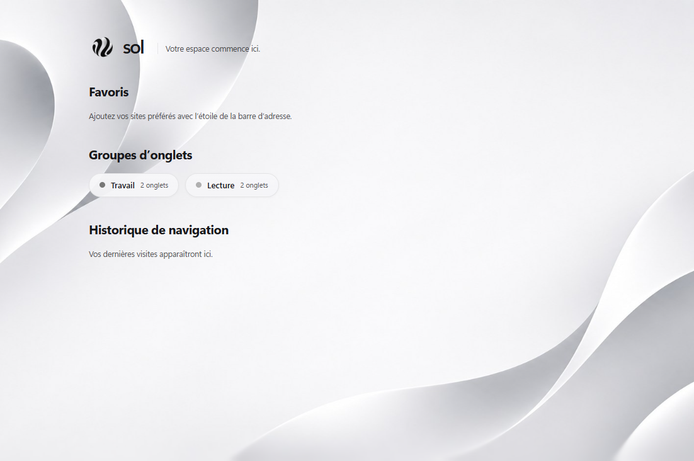
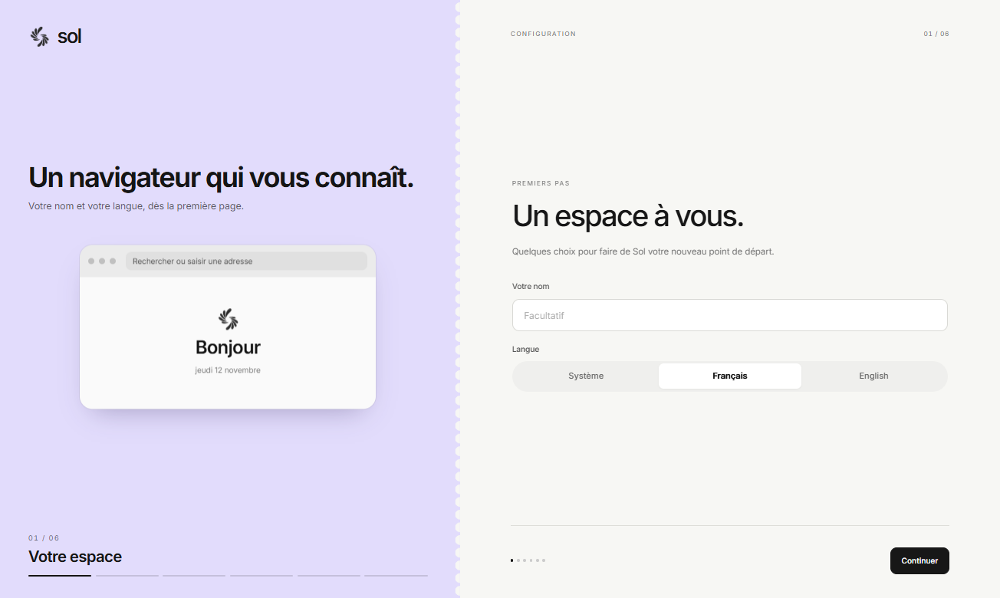

<p align="center"></p>

# Sol

**Sol browser** est un navigateur web léger pour Windows, avec les onglets dans une carte latérale, les extensions du Chrome Web Store et de Microsoft Edge Add-ons, la voix locale sur Windows x64 et des outils pour les développeurs web. Son interface prend les couleurs de la page affichée.

*[English version](README.md)*





> Un projet personnel, partagé tel quel : tout n'est pas encore poli.

## Ce qu'il fait

**Naviguer au quotidien**
- Les onglets dans une carte latérale qu'on redimensionne ou qu'on masque. Glissez un onglet pour le déplacer, ou sur un groupe pour l'y ajouter ; glissez-le dehors pour l'en retirer.
- Un onglet épinglé reste à sa place quand on le ferme : sa page est déchargée et revient au clic.
- Groupes d'onglets nommés et colorés, vue scindée (deux pages côte à côte), mode lecteur (`F9`), favoris et historique.
- **Sessions isolées par onglet** (`Ctrl+Maj+B`) : ouvrez des onglets aux cookies et comptes séparés au sein d'un même profil, en complément des profils distincts et des fenêtres privées effacées à la fermeture.
- **Extensions** du Chrome Web Store, de Microsoft Edge Add-ons, reprises des navigateurs Chromium déjà installés ou chargées depuis un dossier en **mode développeur** (avec rechargement direct depuis les sources).
- **Notes riches hors ligne** (`Ctrl+Maj+M`, note rapide `Ctrl+Maj+Q`) avec Markdown, pièces jointes et mémos vocaux.
- **Téléchargements accélérés et médias** : téléchargements HTTP multi-connexions lorsque le serveur le permet, et téléchargement vidéo ou audio appuyé sur les versions officielles de `yt-dlp`, `FFmpeg` et `Deno` récupérées à la demande et vérifiées par SHA-256.
- Des raccourcis qui ouvrent leur site sur place, et la réouverture de la session au démarrage.
- Sol s'ouvre en plein écran avec toute son interface ; le bouton vert repasse en fenêtre. Une vidéo en plein écran occupe tout l'écran.
- En français et en anglais, selon la langue de Windows.

**Vos données**
- Configuration à la première ouverture : votre nom, la langue, le thème, la police, le moteur de recherche ou la restauration d'une sauvegarde.
- Import depuis Chrome, Edge, Brave, Comet, Arc, Vivaldi et Opera : favoris, historique et mots de passe enregistrés (ou export CSV).
- **Sauvegarde locale et Sol Cloud** : réglages, onglets, sessions, favoris, historique, notes, mots de passe et extensions réunis dans une archive chiffrée sur votre appareil par une clé que vous choisissez. Pour un fichier exporté localement, Sol ne garde pas la clé ; pour la sauvegarde facultative **Sol Cloud** (manuelle ou automatique toutes les 24 h), la clé reste uniquement sur votre PC protégée par Windows DPAPI pour votre compte Windows (jamais transmise au serveur, effacée à la déconnexion).

**Apparence**
- Thème clair, sombre, celui de Windows ou celui de la page.
- La couleur de l'interface suit la page, y compris la vidéo en cours ou la partie de la page à l'écran. Chaque zone peut être désactivée.
- Polices de l'interface : système, Inter, Segoe UI, Geist, Manrope, DM Sans, Plus Jakarta Sans, Outfit, Figtree, Nunito ou Lora.
- Fond du nouvel onglet : l'image de Sol, une image personnelle, une photo d'Unsplash au choix, ou une nouvelle chaque jour.

**Moins de distractions**
- Lecteur flottant : quittez un onglet où une vidéo joue, elle reste à l'écran dans la fenêtre vidéo du moteur (Picture-in-Picture).
- Les sites demandent une fois l'accès au micro, à la caméra ou à la position ; la réponse est retenue par site et peut être oubliée.

**Économe en mémoire**
- Les onglets inactifs passent en veille après 30 secondes jusqu'à 4 Go de RAM, 1 minute jusqu'à 8 Go et 5 minutes au-delà ; les pages sûres sont déchargées après 10, 15 ou 30 minutes respectivement.
- **Sous pression mémoire** (RAM disponible inférieure à 1/8 de la RAM totale, bornée entre 256 Mo et 1 Go), les seuils descendent automatiquement à **15 secondes** avant mise en veille et **2 minutes** avant déchargement.
- Les brouillons, médias actifs et onglets privés gardent leur document actif ; les onglets restaurés ne se chargent que lorsqu'on les affiche. Un seul processus de rendu par site.

**Pour les développeurs**
- Simulateur d'appareils avec leur vraie forme, rotation, et plusieurs écrans côte à côte.
- Inspecteurs réseau et design : requêtes, filtre API, erreurs, en-têtes, corps des réponses et simulations HTTP.
- `:3000` ouvre `http://localhost:3000`, et un serveur pas encore démarré est retenté tout seul.
- Captures d'une zone, de la partie visible ou de la page entière, en PNG ou en PDF, avec un aperçu avant d'enregistrer. Un appareil simulé est capturé avec sa coque.


## Sol AI

Un assistant facultatif qui utilise **votre propre forfait ChatGPT Plus ou Pro** via *Sign in with ChatGPT* : pas de clé API, pas de facture en plus. Il se connecte dans *Paramètres → Sol*.

<p align="center"></p>

- **Interroger le site, pas un extrait.** Sol AI lit l'onglet ouvert de façon structurée (titres, texte, liens, boutons, champs), y cherche, suit les liens d'une documentation et met en évidence le passage utilisé. Chaque étape s'affiche en direct.
- **Votre accord avant d'agir.** Autorisez chaque action ou choisissez *Toujours autoriser* dans la discussion ou les paramètres Sol AI. Cet accord s’applique aux sites de ce profil, reste au redémarrage et peut être retiré dans les paramètres. Les champs de mot de passe, de carte et de code unique ne sont jamais lus ni remplis.
- **Actions en un clic.** *Résumer* dans la barre d'adresse ; clic droit sur une sélection pour l'expliquer ou la traduire (six langues), ou dans un champ pour corriger, reformuler ou traduire, puis remplacer le texte.
- **Panneau de discussion** à droite pour les questions rapides, capable de consulter l'onglet ouvert.
- **Agent navigateur** : examiner les contraintes et erreurs des formulaires, remplir les champs, utiliser le clavier, extraire des tableaux et liens réels, attendre un résultat, rechercher, dupliquer et épingler les onglets, préparer un espace avec une note. L’agent vérifie les résultats et renouvelle les références périmées avant de réessayer.
- **Voix locale sur Windows x64 (`Ctrl+M`)** : le son du microphone est segmenté sur l'appareil par Silero VAD et transcrit localement par Parakeet (`transcribe.cpp`), seul le texte transcrit est envoyé à ChatGPT et les réponses sont lues localement par Piper avec le Voice Orb de beUI. Les modèles vocaux ne sont téléchargés que si vous installez la voix, vérifiés par SHA-256 dans `%USERPROFILE%\.sol\voice-models`.
- **Aide au développement web** : expliquer une erreur console ou réseau avec ChatGPT, proposer un correctif, piloter la capture et les simulations HTTP, ouvrir les DevTools et tester le responsive. Les diagnostics sont transmis uniquement pour l’analyse demandée, avec masquage des secrets connus.
- **Notes** : chercher, résumer, ou créer une note riche à partir d'une consigne.
- **Sujets sur la page d'accueil** : favoris et historique classés par catégorie une fois par jour. Désactivé par défaut ; seuls les titres et domaines sont envoyés.

Seul ce sur quoi vous agissez part chez OpenAI. Les jetons de connexion restent chiffrés sur votre PC, et Sol AI ne fonctionne pas en navigation privée.

## Télécharger

Prenez la dernière version sur la page [Releases](https://gitlab.com/stevencrdkoulo/sol-browser/-/releases).

| Votre Windows | Installateur | Archive portable |
|---|---|---|
| 64 bits Intel ou AMD (la plupart des PC) | `Sol-<version>-win-x64-Setup.exe` | `Sol-<version>-win-x64.zip` |
| ARM (PC Snapdragon) | `Sol-<version>-win-arm64-Setup.exe` | `Sol-<version>-win-arm64.zip` |
| 32 bits | `Sol-<version>-win-x86-Setup.exe` | `Sol-<version>-win-x86.zip` |

**L'installateur** installe Sol pour votre compte, sans droits d'administrateur, et crée les raccourcis. Un Sol installé :
- se met à jour tout seul : une nouvelle version se télécharge en arrière-plan, puis un encart en bas à droite propose de redémarrer ;
- est reconnu par Windows comme navigateur, dans « Ouvrir avec » pour les pages web et les PDF, et dans *Paramètres → Applications → Applications par défaut*.

**L'archive** ne demande aucune installation : décompressez-la où vous voulez et lancez `Sol.exe`. Elle ne se met pas à jour toute seule.

Configuration requise : Windows 10 version 1809 ou plus récent, et le **WebView2 Runtime** de Microsoft Edge, livré avec Windows 11 et la plupart des Windows 10 ([à télécharger](https://developer.microsoft.com/microsoft-edge/webview2/) s'il manque).

### « Windows a protégé votre ordinateur »

Les fichiers ne sont **pas signés** : un certificat de signature coûte de l'argent que ce projet n'a pas. Windows SmartScreen avertit au premier lancement ; choisissez *Informations complémentaires* → *Exécuter quand même*.

Vous pouvez vérifier un téléchargement avec l'empreinte publiée dans chaque version (`SHA256SUMS.txt`) :

```powershell
Get-FileHash .\Sol-1.2.13-win-x64-Setup.exe -Algorithm SHA256
```

## Vie privée

- Aucune télémétrie envoyée à l’auteur de Sol. Sol AI et Sol Cloud sont facultatifs.
- Favoris, historique, notes, mots de passe et réglages restent sur votre ordinateur, sauf export d'une sauvegarde locale ou envoi d'une archive chiffrée de bout en bout vers Sol Cloud (dont la clé reste uniquement sur votre PC sous Windows DPAPI et s'efface à la déconnexion).
- Sur Windows x64, la voix locale traite le microphone sur votre PC ; seul le texte transcrit est envoyé à OpenAI si vous êtes connecté, et les modèles vocaux sont téléchargés à la demande depuis Hugging Face.
- Les connexions que Sol établit de lui-même ou lors de l'usage d'une fonction :
  - les suggestions de recherche, envoyées à votre moteur pendant la saisie dans la barre d'adresse (désactivable) ;
  - la recherche d'une nouvelle version de Sol sur GitLab au démarrage (copies installées seulement) et des mises à jour d'extensions du Chrome Web Store ou de Microsoft Edge Add-ons ;
  - les icônes des sites de vos raccourcis, et les photos/vignettes `picsum.photos` si vous choisissez un fond en ligne ;
  - les archives officielles `yt-dlp`, `FFmpeg` et `Deno` depuis GitHub Releases lors du premier téléchargement vidéo ou audio.
- Les pages web n'ont aucun canal vers le code du navigateur.

## Raccourcis clavier

| | |
|---|---|
| `Ctrl+T` / `Ctrl+W` | Nouvel onglet / fermer l'onglet |
| `Ctrl+Maj+T` | Rouvrir le dernier onglet fermé |
| `Ctrl+Maj+N` | Nouvelle fenêtre privée |
| `Ctrl+Maj+B` | Session isolée de cet onglet |
| `Ctrl+L` | Barre d'adresse |
| `Ctrl+M` | Activer ou arrêter la voix de Sol AI (Windows x64) |
| `Ctrl+Maj+M` / `Ctrl+Maj+Q` | Ouvrir les notes / note rapide |
| `Ctrl+Maj+P` | Palette de commandes |
| `Ctrl+Tab` / `Ctrl+Maj+Tab` | Onglet suivant / précédent |
| `Alt+←` / `Alt+→` | Page précédente / suivante |
| `Ctrl +` / `Ctrl -` / `Ctrl 0` | Zoom avant / arrière / réinitialiser |
| `F5` / `F9` | Recharger / Mode lecteur |

## Compiler depuis les sources

Il faut Windows, le [SDK .NET 10](https://dotnet.microsoft.com/download) et [Node.js](https://nodejs.org) (LTS en cours).

```powershell
cd ui
npm ci
npm run build          # l'interface (React), copiée à côté de l'exécutable par la compilation
cd ..
dotnet test tests/Browser.Core.Tests
dotnet run --project src/Browser.App
```

Fichiers publiables pour les trois architectures : `pwsh tools/publish.ps1 -Arch x64,arm64,x86`. Les installateurs sont construits aussi quand l'outil Velopack est présent (`dotnet tool install -g vpk`).

`tools/env.ps1` est un script de développement facultatif qui place les SDK, caches et données de test dans `\dev` sur le disque où se trouve le dépôt ; vous n'en avez pas besoin sur une installation standard.

## Comment c'est fait

- **Moteur** : Microsoft Edge WebView2 (Chromium), une vue par onglet.
- **Hôte** : C# / .NET 10 avec WinUI 3 (`src/Browser.App`). Il détient tout l'état.
- **Logique** : du C# simple et testé, sans dépendance à l'interface (`src/Browser.Core`, tests dans `tests/`).
- **Interface** : React et TypeScript (`ui/`), chargée depuis des fichiers locaux sous une politique de sécurité stricte, avec l'éditeur hors ligne Vditor pour les notes et les composants agents de [beUI](https://beui.dev).
- **Sol AI & Voix** : l'API Responses de ChatGPT avec *Sign in with ChatGPT* (OAuth PKCE, jetons protégés par Windows DPAPI), les outils de page dans `src/Browser.App/inject/agent.js`, et un moteur vocal local x64 (`tools/voice-worker`, Silero VAD + `transcribe.cpp` + Piper).
- **Sol Cloud** : service facultatif de sauvegarde Hono / PostgreSQL / S3 (`cloud/`) ne stockant que des archives scellées sur l'appareil.
- **Installateur et mises à jour** : [Velopack](https://velopack.io), qui lit les versions publiées dans ce dépôt.

## Publier une version (mainteneurs)

1. Régler `<Version>` dans `src/Browser.App/Browser.App.csproj`.
2. Poser l'étiquette et la pousser : `git tag v1.2.13 && git push origin v1.2.13`.
3. La tâche `release` du pipeline construit les installateurs et les archives des trois architectures, publie leurs empreintes et crée la version sur GitLab. Les copies installées la récupèrent de là.

## Politique de signature du code

Les versions ne sont pas encore signées. Une demande à la [SignPath Foundation](https://signpath.org), qui signe gratuitement les projets open source, est prévue ; en attendant, utilisez les empreintes décrites plus haut.

- Auteur des modifications, relecteur et approbateur : [Steven KOULO](https://gitlab.com/stevencrdkoulo).
- Chaque fichier publié est construit par le [pipeline de publication](.gitlab-ci.yml) à partir d'un commit étiqueté de ce dépôt ; rien n'est construit ni déposé à la main.
- Vie privée : Sol n'envoie aucune télémétrie à son auteur. Voir [Vie privée](#vie-privée) pour les connexions qu'il établit.

## Licence

[MIT](LICENSE). Les logiciels tiers livrés avec Sol sont listés dans [THIRD-PARTY-NOTICES.md](THIRD-PARTY-NOTICES.md).
